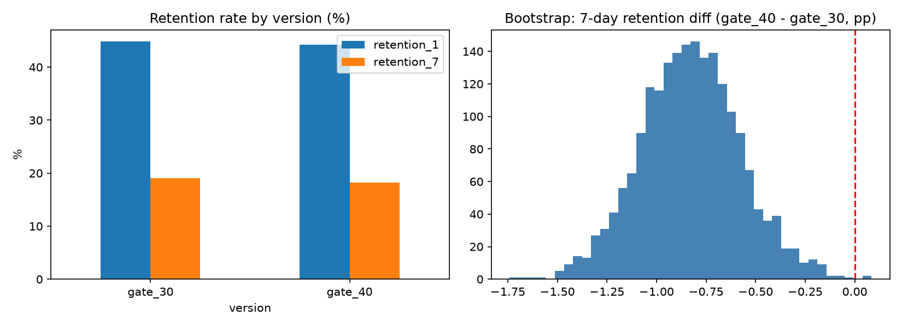

# A/B Test: Cookie Cats Gate Placement

## Question
A mobile game moved its first progression gate from level 30 (control) to level 40 (treatment). Does this change player retention?

## Data
90,189 players, randomly assigned to gate_30 or gate_40. Metrics: 1-day retention, 7-day retention, total game rounds. Source: Kaggle, "Mobile Games A/B Testing - Cookie Cats".

## Method
- Sample ratio mismatch check (chi-square goodness of fit)
- Two-proportion z-test and chi-square test for retention
- 95% confidence intervals for the difference
- Bootstrap (2,000 resamples) for 7-day retention
- Mann-Whitney U test for game rounds (skewed distribution, outliers removed)
- Power analysis (minimum detectable effect)

## Results
| Metric | gate_30 | gate_40 | Difference | p-value |
|---|---|---|---|---|
| 1-day retention | 44.82% | 44.23% | -0.59 pp | 0.074 (not significant) |
| 7-day retention | 19.02% | 18.20% | -0.82 pp (CI -1.33 to -0.31) | 0.0016 (significant) |
| Median game rounds | 17 | 16 | -1 | 0.045 (marginal) |

Bootstrap: 99.9% probability that gate_40 has lower 7-day retention.

## Recommendation
**Do not move the gate to level 40. Keep it at level 30.** The 7-day retention drop is statistically significant and the confidence interval is entirely below zero. A later gate gives no retention benefit.

## Limitations
- Group sizes differ slightly (45,489 vs 44,700, SRM p=0.009). This is borderline, but the randomisation should be checked before a real rollout.
- Three metrics were tested. After a Bonferroni correction (alpha = 0.017), only the 7-day retention result stays significant.
- No revenue data, so the effect on monetisation is unknown.

## Tech
Python, Pandas, NumPy, SciPy, Statsmodels, Matplotlib

## How to run
    python -m pip install pandas numpy scipy statsmodels matplotlib
    python src/ab_test.py

Put cookie_cats.csv in data/raw/ first (Kaggle download).
